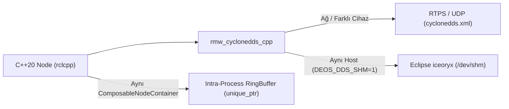

# DEOS — C++ Geçişi, CycloneDDS ve iceoryx Shared Memory Rehberi

Bu doküman hem **CycloneDDS ve Eclipse iceoryx'in nasıl çalıştığını öğrenmek** hem de **DEOS otonom araç mimarisini Python'dan C++20'ye taşırken sıfır kopyalı (zero-copy) iletişimi doğru kurmak** için hazırlanmıştır.

---

## 1. Kavramsal Temeller: DDS, CycloneDDS ve iceoryx Nasıl Çalışır?

### 1.1 ROS 2'de Mesajın Yolculuğu (RMW Katmanı)
ROS 2 düğümleri (`rclcpp` / `rclpy`) doğrudan soket açmaz; **RMW (ROS Middleware)** arayüzü üzerinden bir DDS gerçeklemesiyle konuşur:



- **Fast DDS (`rmw_fastrtps_cpp`)**: ROS 2 Jazzy kurulum varsayılanıdır. micro-ROS ajanı (`deos_micro_ros_agent`) içeride XRCE-DDS -> Fast DDS köprüsü kullanır.
- **Eclipse CycloneDDS (`rmw_cyclonedds_cpp`)**: C ile yazılmış, düşük CPU izine ve deterministik bellek davranışına sahip DDS motorudur. **OMG RTPS** tel protokolü standart olduğu için DEOS konteyneri CycloneDDS çalıştırırken `micro_ros_agent` (Fast DDS) ile UDP üzerinden sorunsuz haberleşmeye devam eder.

### 1.2 Büyük Mesajlarda (PointCloud2 / Image) UDP Tuzağı ve Çözümü
Bir kamera karesi (`640×480 BGR8` ≈ **921 KB**) veya tam tur SICK LiDAR nokta bulutu tek bir Ethernet/loopback UDP paketine (64 KB) sığmaz; IP katmanında onlarca parçaya (fragment) bölünür.
- Linux çekirdeğinin varsayılan UDP alım tamponu (`net.core.rmem_max` ≈ **212 KB**) tek bir kareden bile küçüktür!
- Tek bir fragment düştüğünde tüm kare çöpe gider; `RELIABLE` QoS açıksa yeniden iletim fırtınası (retransmission storm) oluşur.
- **DEOS Çözümü**:
  1. [config/dds/cyclonedds.xml](../config/dds/cyclonedds.xml) içinde `<SocketReceiveBufferSize max="16MB"/>` tanımlandı.
  2. Raspberry Pi host üzerinde `sudo bash ops/scripts/setup_dds_sysctl.sh` komutu `net.core.rmem_max=33554432` (32 MB) değerini kalıcı olarak yazar.
  3. Sensör akışlarında `deos::qos::sensor_data()` (`BEST_EFFORT` + `VOLATILE`) kullanılarak eski karelerin yeniden iletilmesi engellendi.

### 1.3 Eclipse iceoryx (`iox-roudi`) ve "Gerçek Zero-Copy" Gerçeği
iceoryx, `/dev/shm` (RAM üzerindeki POSIX paylaşımlı bellek) içinde önceden ayrılmış sabit boyutlu bellek havuzlarını (**mempool**) yöneten **RouDi** adlı bir arka plan sürecidir ([config/dds/roudi.toml](../config/dds/roudi.toml)):
1. Yayıncı (`Publisher`), RouDi'den uygun boyuttaki bir **chunk**'ın bellek adresini ödünç alır (`borrow_loaned_message()`).
2. Veriyi doğrudan `/dev/shm` içindeki o adrese yazar ve `publish()` çağırır.
3. Abone (`Subscription`), sadece 8 baytlık ofset işaretçisini alır; **0 serileştirme (CDR yok), 0 `memcpy`** ile veriyi doğrudan okur.

> **En Çok Karıştırılan Nokta — Neden `sensor_msgs/Image` ve `PointCloud2` iceoryx ile Zero-Copy Değildir?**
> `borrow_loaned_message()` yalnızca bellekte düz ve sabit boyutlu (**POD / TriviallyCopyable**, `rosidl_generator_traits::has_fixed_size<T>::value == true`) mesajlarda çalışır.
> - `std_msgs/Header` içinde `string frame_id` (`std::string`, heap işaretçisi) vardır!
> - `sensor_msgs/Image` ve `PointCloud2` içinde sınırsız `uint8[] data` (`std::vector`, heap işaretçisi) vardır!
> Başka bir süreç sizin sürecinizin heap işaretçisini çözemeyeceği için CycloneDDS bu tipleri SHM açıkken bile **CDR ile serileştirip kopyalar** (yalnızca soket yerine SHM tamponunu taşıyıcı olarak kullanır).

---

## 2. DEOS İki Katmanlı C++ Zero-Copy Mimarisi

DEOS'ta C++ geçişi için her iki duruma da uygun altyapı kurulmuştur:

| Senaryo | Kullanılacak Mekanizma | Mesaj Tipi Kısıtı | Paket / Yardımcı |
|---|---|---|---|
| **Aynı süreçteki C++ algı/lokalizasyon düğümleri** (önerilen birincil yol) | `ComposableNodeContainer` (`component_container_mt`) + `use_intra_process_comms(true)` + `std::unique_ptr` | **Kısıt yok!** `PointCloud2`, `Image`, `Detection3DArray` dahil her tipte **0 kopya** (`pub_ptr == sub_ptr`) | `licam_fusion` + `deos_perception_container` |
| **Farklı süreçler arası yüksek bant genişlikli C++ düğümleri** (ör. izole kamera/Hailo sürücüsü -> algı) | CycloneDDS + `iox-roudi` (`DEOS_DDS_SHM=1`) + `deos::publish_zero_copy()` | **Sabit boyutlu POD** (`has_fixed_size == true`) | `deos_shm_msgs` (`FixedFrame640x480`, `FixedPointCloud64k`) + `deos_cpp_common/zero_copy.hpp` |
| **Kontrol / Planlama / Python / micro-ROS** | CycloneDDS standart yayın (`deos::qos::control_reliable()`) | Standart ROS 2 mesajları (`Twist`, `Bool`, `Float32`) | Tüm düğümler |

### Kritik `rclcpp` Tuzağı ve `deos::publish_zero_copy()`
ROS 2 Jazzy'de bir düğümde `use_intra_process_comms(true)` açıkken doğrudan `pub->borrow_loaned_message()` çağırırsanız `rclcpp` çalışma zamanında **istisna (exception)** fırlatır (*"Borrowing loaned messages is not supported with intra-process communication"*).

[zero_copy.hpp](../DEOS/deos_ws/src/deos_cpp_common/include/deos_cpp_common/zero_copy.hpp) içindeki `deos::publish_zero_copy(pub, intra_enabled, populate_fn)` bu durumu derleme ve çalışma zamanında güvenli şekilde yönetir:
- `is_shm_zero_copy_capable_v<MsgT>` (`has_fixed_size`) **ve** `!intra_enabled` **ve** `pub.can_loan_messages()` ise doğrudan iceoryx `/dev/shm` chunk'ını ödünç alır.
- Aksi halde `std::make_unique<MsgT>()` üretip `std::move` ile yayınlar (intra-process açıksa yine 0 kopya çalışır).

---

## 3. Kurulan Altyapı Haritası

- **DDS & RouDi Yapılandırması**:
  - [config/dds/cyclonedds.xml](../config/dds/cyclonedds.xml) — Varsayılan CycloneDDS profili (SHM kapalı, 16 MB alım tamponu).
  - [config/dds/cyclonedds_shm.xml](../config/dds/cyclonedds_shm.xml) — iceoryx SHM açık profil.
  - [config/dds/roudi.toml](../config/dds/roudi.toml) — Kamera (1 MB) ve LiDAR (4 MB) karelerine göre boyutlandırılmış RouDi mempool havuzları (~190 MB `/dev/shm`).
  - [ops/scripts/deos_dds_env.sh](../ops/scripts/deos_dds_env.sh) — `DEOS_DDS_SHM=1` ise `iox-roudi`'yi başlatır; RouDi ayağa kalkamazsa aracı durdurmak yerine otomatik olarak `cyclonedds.xml`'e düşer (**fail-operational fallback**).
  - [ops/scripts/setup_dds_sysctl.sh](../ops/scripts/setup_dds_sysctl.sh) — Raspberry Pi host kernel UDP tampon ayarı.
- **Derleme Altyapısı**:
  - [config/colcon/defaults.yaml](../config/colcon/defaults.yaml) — `Release`, `compile_commands.json`, `ccache` ve Pi 5'te bellek taşmasını önleyen `parallel-workers: 2`.
- **Ortak C++ Paketleri**:
  - [DEOS/deos_ws/src/deos_shm_msgs](../DEOS/deos_ws/src/deos_shm_msgs) — `FixedFrame640x480.msg` ve `FixedPointCloud64k.msg`.
  - [DEOS/deos_ws/src/deos_cpp_common](../DEOS/deos_ws/src/deos_cpp_common) — `topic_layout.hpp`, `qos.hpp`, `zero_copy.hpp` ve `shm_zero_copy_bench` ölçüm aracı.
  - [ops/scripts/check_topic_layout_sync.py](../ops/scripts/check_topic_layout_sync.py) — Python ve C++ topic tablolarının kaymasını engelleyen otomatik test.
- **Algı Entegrasyonu (`licam_fusion`)**:
  - [licam_fusion](../DEOS/deos_ws/src/licam_fusion) `deos_cpp_common` ile bağlandı, `deos_root: "/deos"` desteği ve Robotaksi sınıf önbilgileri (`cone`, `barrier`) eklendi.
  - [stereo_detector_node.py](../DEOS/deos_ws/src/perception/obstacle_detection/vision_bridge/vision_bridge/stereo_detector_node.py) kamera zaman damgasını koruyarak `/deos/perception/stereo/detections_2d` (`vision_msgs/Detection2DArray`) yayınlıyor.
  - [main.launch.py](../DEOS/deos_ws/src/vehicle_bringup/launch/main.launch.py) içinde `deos_perception_container` (`component_container_mt`) başlatıldı; yeni yazacağınız C++ algı düğümlerini doğrudan bu konteynerin `composable_node_descriptions` listesine ekleyebilirsiniz.

---

## 4. Uygulamalı Öğrenme ve Doğrulama Komutları

### Adım 1 — Raspberry Pi Host'ta Kernel Tamponunu Ayarlayın (Bir Kez)
```bash
sudo bash ops/scripts/setup_dds_sysctl.sh
```

### Adım 2 — Aktif RMW'yi ve C++ Bileşen Konteynerini Doğrulayın
Container içinde:
```bash
ros2 doctor --report | grep -A3 "RMW MIDDLEWARE"
ros2 component list
```
Beklenen çıktı: `middleware name : rmw_cyclonedds_cpp` ve `/deos_perception_container` altında `licam_fusion::FusionNode`.

### Adım 3 — 3 Modlu Zero-Copy Benchmark'ını Çalıştırın (Öğrenme Lab'ı)
Önce **SHM kapalıyken** (standart CycloneDDS):
```bash
ros2 run deos_cpp_common shm_zero_copy_bench --samples 60
```
Ardından **iceoryx RouDi + SHM açıkken**:
```bash
DEOS_DDS_SHM=1 bash -c "source /ros2_ws/ops/scripts/deos_dds_env.sh && \
  ros2 run deos_cpp_common shm_zero_copy_bench --samples 60"
```
Tabloda şunları gözlemleyeceksiniz:
1. `Standart DDS (Image 921KB)`: `LoanSHM? = HAYIR` (çünkü `sensor_msgs/Image` dinamik boyutlu).
2. `Sabit Mesaj (Fixed 921KB)`: SHM kapalıyken `LoanSHM? = HAYIR`, `DEOS_DDS_SHM=1` iken **`LoanSHM? = EVET`, `Aktif Yol = iceoryx_loaned_shm`** ve gecikmede belirgin düşüş!
3. `Intra-Process (Image 921KB)`: **`ayni_ptr=EVET`** — dinamik `Image` mesajında bile kopyasız bellek adresi devri!

### Adım 4 — Canlı iceoryx Mempool ve CycloneDDS Ham Performans İzleme
```bash
# RouDi bellek havuzlarının anlık chunk doluluğunu izle:
iox-introspection-client --mempool

# Saf CycloneDDS pub/sub throughput ve gecikme testi (iki ayrı terminalde):
ddsperf sub
ddsperf pub size 100k rate 100
```

### Adım 5 — Tüm Sistemde iceoryx SHM'yi Kalıcı Açmak
[docker-compose.yml](../docker-compose.yml) içindeki `DEOS_DDS_SHM=0` satırını `DEOS_DDS_SHM=1` yapmanız yeterlidir; `deos_autostart.sh` açılışta `iox-roudi`'yi otomatik başlatır ve `startup_check.sh` sağlık durumunu raporlar.

---

## 5. Yeni Bir Modülü Python'dan C++20'ye Taşıma Şablonu

Yeni yazacağınız her C++ paketi (ör. `lidar_obstacle_cpp`, `lane_tracking_cpp`, `vehicle_controller_cpp`) için standart DEOS kalıbı:

1. `package.xml` ve `CMakeLists.txt` içine `deos_cpp_common` ve `rclcpp_components` ekleyin (`licam_fusion/CMakeLists.txt` referans şablondur).
2. Düğüm kurucusunda intra-process iletişimi ve ortak topic/QoS yapısını kullanın:
   ```cpp
   #include "deos_cpp_common/qos.hpp"
   #include "deos_cpp_common/topic_layout.hpp"

   MyPerceptionNode::MyPerceptionNode(const rclcpp::NodeOptions & options)
   : Node("my_perception_node", rclcpp::NodeOptions(options).use_intra_process_comms(true)) {
       const auto root = this->declare_parameter<std::string>("deos_root", "/deos");
       const auto T = deos::build_deos_topics(root);

       sub_ = this->create_subscription<sensor_msgs::msg::PointCloud2>(
           T.sensors_lidar_cloud_unstructured_fullframe,
           deos::qos::sensor_data(5),
           [this](sensor_msgs::msg::PointCloud2::ConstSharedPtr msg) { /* ... */ });
   }
   ```
3. Yayınlarken `auto out = std::make_unique<OutMsg>(); ... pub_->publish(std::move(out));` (veya sabit boyutlu süreçler arası mesajlarda `deos::publish_zero_copy(...)`) kullanın.
4. Düğümü `RCLCPP_COMPONENTS_REGISTER_NODE(...)` ile kaydedip `main.launch.py` içindeki `deos_perception_container` listesine ekleyin.
